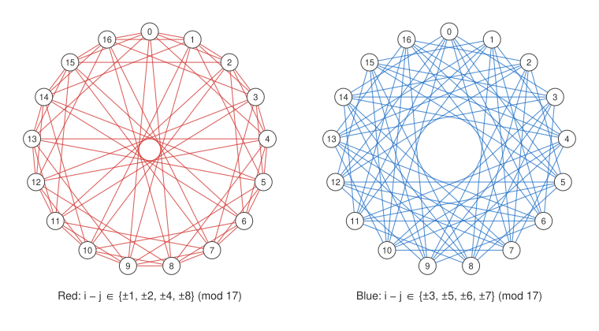

# Introduction to Graph Theory — Ramsey Numbers

## 1 Warm-up: The Party Problem

**Question.** At any gathering of six people, must there be three people who are pairwise acquainted, or three people who are pairwise strangers?

**Modelling.**

- People correspond to vertices.
- Any two people are either acquainted or not, so each edge receives one of two colors: acquainted means red (R), strangers means blue (B).
- Three mutual acquaintances form a red triangle, that is, a red $$K_3$$.
- Three mutual strangers form a blue $$K_3$$.

The question thus becomes: **does every red–blue coloring of the edges of $$K_n$$ contain a monochromatic $$K_3$$?**

**Answer.** For $$n = 6$$ it always does, whereas $$K_5$$ admits a coloring with no monochromatic $$K_3$$. Hence $$R(3,3) = 6$$.

**Try it yourself.** [Open the interactive edge-coloring game](/math-talks/ramsey-numbers/party-game.html): color the edges of $$K_5$$ or $$K_6$$ red or blue and try to avoid a monochromatic triangle.

## 2 Basic Definitions

For a set $$V$$, we write $$\binom{V}{2}$$ for the set of all $$2$$-element subsets of $$V$$.

**Definition 2.1 (Simple graph).** A *simple graph* $$G = (V, E)$$ consists of a *vertex set* $$V$$ and an *edge set* $$E \subseteq \binom{V}{2}$$. If $$\{u, v\} \in E$$, which we abbreviate as $$uv \in E$$, we say that $$u$$ and $$v$$ are *adjacent*.

**Definition 2.2 (Complete graph).** The *complete graph* $$K_n$$ has $$\lvert V \rvert = n$$ and $$E = \binom{V}{2}$$; that is, every two distinct vertices are joined by an edge.

**Proposition 2.3.** The number of edges of $$K_n$$ is

$$\lvert E(K_n) \rvert = \binom{n}{2} = \frac{n(n-1)}{2}.$$

**Definition 2.4 (Degree).** The *degree* of a vertex $$v$$ is

$$\deg(v) = \bigl\lvert \{ u \in V : uv \in E \} \bigr\rvert.$$

In $$K_n$$, every vertex $$v$$ satisfies

$$\deg_{K_n}(v) = n - 1.$$

**Definition 2.5 (Subgraph; clique).** A graph $$H$$ is a *subgraph* of $$G$$ if $$V(H) \subseteq V(G)$$ and $$E(H) \subseteq E(G)$$. If $$k$$ vertices of $$G$$ are pairwise adjacent, they span a copy of $$K_k$$, called a *$$k$$-clique*.

**Definition 2.6 (Edge 2-coloring).** A *red–blue coloring* of the edges of $$K_n$$ is a map

$$c : E(K_n) \to \{\text{red}, \text{blue}\},$$

which partitions the edge set as $$E = E_R \sqcup E_B$$. We call $$(V, E_R)$$ the *red graph* and $$(V, E_B)$$ the *blue graph*.

**The basic question.** Given a coloring $$c$$, is there a set $$S \subseteq V$$ with $$\lvert S \rvert = 3$$ whose three edges all have the same color? Equivalently, does the red graph or the blue graph contain a $$K_3$$?

## 3 Ramsey Numbers

**Definition 3.1 (Ramsey number).** For integers $$s, t \ge 2$$, the *Ramsey number* $$R(s,t)$$ is the least positive integer $$n$$ such that every red–blue coloring of the edges of $$K_n$$ contains a red $$K_s$$ or a blue $$K_t$$.

That such an $$n$$ exists at all is Ramsey's theorem (1930); it also follows from Theorem 5.1 below.

**How to determine $$R(s,t)$$.**

- To prove $$R(s,t) \le n$$: show that *every* 2-coloring of $$K_n$$ contains a red $$K_s$$ or a blue $$K_t$$.
- To prove $$R(s,t) > m$$: exhibit *one* 2-coloring of $$K_m$$ containing neither a red $$K_s$$ nor a blue $$K_t$$.
- Then $$R(s,t) = n$$ if and only if both $$R(s,t) \le n$$ and $$R(s,t) > n - 1$$.

## 4 Proof that R(3,3) = 6

### 4.1 Two Basic Properties

**Proposition 4.1 (Symmetry).** For all $$s, t \ge 2$$, $$R(s,t) = R(t,s)$$.

*Proof.* Let $$n = R(s,t)$$, and let $$c$$ be an arbitrary 2-coloring of $$K_n$$. Let $$\bar{c}$$ be the coloring obtained from $$c$$ by interchanging red and blue. Since $$n = R(s,t)$$, the coloring $$\bar{c}$$ contains a red $$K_s$$ or a blue $$K_t$$. Interchanging the colors back, $$c$$ contains a blue $$K_s$$ or a red $$K_t$$. Since $$c$$ was arbitrary, every 2-coloring of $$K_n$$ contains a red $$K_t$$ or a blue $$K_s$$, so $$R(t,s) \le n = R(s,t)$$. Exchanging the roles of $$s$$ and $$t$$ gives $$R(s,t) \le R(t,s)$$, and therefore $$R(s,t) = R(t,s)$$. ∎

**Proposition 4.2 (Base cases).** For all $$s, t \ge 2$$, $$R(2,t) = t$$ and $$R(s,2) = s$$.

*Proof.* We prove $$R(2,t) = t$$.

- $$R(2,t) \le t$$: in any 2-coloring of $$K_t$$, either some edge is red, giving a red $$K_2$$, or every edge is blue, giving a blue $$K_t$$.
- $$R(2,t) > t - 1$$: color every edge of $$K_{t-1}$$ blue. There is no red edge, hence no red $$K_2$$, and there are only $$t - 1$$ vertices, hence no blue $$K_t$$.

Therefore $$R(2,t) = t$$. By symmetry, $$R(s,2) = s$$. ∎

### 4.2 The Lower Bound R(3,3) ≥ 6

We construct a 2-coloring of $$K_5$$ containing neither a red $$K_3$$ nor a blue $$K_3$$.

Take $$V = \{0, 1, 2, 3, 4\}$$, with all indices read modulo $$5$$, and set

- red edges $$E_R = \bigl\{ \{i, i+1\} : i \in \mathbb{Z}_5 \bigr\}$$: five edges forming a pentagon, a copy of the cycle $$C_5$$;
- blue edges $$E_B = \bigl\{ \{i, i+2\} : i \in \mathbb{Z}_5 \bigr\}$$: the five diagonals, forming a pentagram, again a copy of $$C_5$$.

**Verification.**

- The red graph and the blue graph are both isomorphic to $$C_5$$.
- Since $$\lvert E_R \rvert + \lvert E_B \rvert = 5 + 5 = 10 = \lvert E(K_5) \rvert$$, every edge receives exactly one color.
- The cycle $$C_5$$ contains no triangle, so there is neither a red $$K_3$$ nor a blue $$K_3$$.

Hence $$R(3,3) > 5$$, and since $$R(3,3)$$ is an integer, $$R(3,3) \ge 6$$.

### 4.3 The Upper Bound R(3,3) ≤ 6

Consider any 2-coloring of $$K_6$$ and fix a vertex $$v$$. It is incident with $$5$$ edges; say $$r$$ of them are red and $$5 - r$$ are blue. By the pigeonhole principle, $$r \ge 3$$ or $$5 - r \ge 3$$; otherwise $$r \le 2$$ and $$5 - r \le 2$$, giving $$5 \le 4$$, a contradiction.

By the symmetry between the two colors, we may assume that $$v$$ is joined by red edges to three vertices $$v_1, v_2, v_3$$.

- If some edge among $$v_1, v_2, v_3$$ is red, say $$v_1 v_2$$, then $$v, v_1, v_2$$ span a red $$K_3$$.
- Otherwise all three edges among $$v_1, v_2, v_3$$ are blue, and they span a blue $$K_3$$.

Thus every 2-coloring of $$K_6$$ contains a monochromatic $$K_3$$, and $$R(3,3) \le 6$$. ∎

### 4.4 Conclusion

$$R(3,3) \ge 6 \quad\text{and}\quad R(3,3) \le 6 \quad\Longrightarrow\quad \boxed{R(3,3) = 6}$$

## 5 A Recursive Upper Bound

**Theorem 5.1.** For all $$s, t \ge 3$$,

$$R(s,t) \le R(s-1,t) + R(s,t-1).$$

In particular, by induction on $$s + t$$ starting from Proposition 4.2, $$R(s,t)$$ is finite for all $$s, t \ge 2$$.

*Proof.* Write $$A = R(s-1,t)$$ and $$B = R(s,t-1)$$, and let $$n = A + B$$. Consider any 2-coloring of $$K_n$$ and fix a vertex $$v$$. It is incident with $$n - 1 = A + B - 1$$ edges; let $$r$$ of them be red and $$b$$ of them blue, so that $$r + b = A + B - 1$$.

*Claim:* $$r \ge A$$ or $$b \ge B$$. Otherwise $$r \le A - 1$$ and $$b \le B - 1$$, whence $$r + b \le A + B - 2$$, contradicting $$r + b = A + B - 1$$.

- **Case 1: $$r \ge A$$.** Let $$N_R(v)$$ be the set of vertices joined to $$v$$ by a red edge, so $$\lvert N_R(v) \rvert \ge A = R(s-1,t)$$. The complete graph on $$N_R(v)$$ therefore contains a red $$K_{s-1}$$ or a blue $$K_t$$. In the first case, adding $$v$$ yields a red $$K_s$$, because every edge from $$v$$ to $$N_R(v)$$ is red. In the second case we already have a blue $$K_t$$.
- **Case 2: $$b \ge B$$.** Symmetrically, the set $$N_B(v)$$ of blue neighbours of $$v$$ satisfies $$\lvert N_B(v) \rvert \ge B = R(s,t-1)$$, so it contains a blue $$K_{t-1}$$, which together with $$v$$ forms a blue $$K_t$$, or else it contains a red $$K_s$$.

In either case the coloring contains a red $$K_s$$ or a blue $$K_t$$, so $$R(s,t) \le A + B$$. ∎

### 5.1 A Sharper Bound When Both Terms Are Even

**Theorem 5.2.** Let $$s, t \ge 3$$. If $$A = R(s-1,t)$$ and $$B = R(s,t-1)$$ are **both even**, then

$$R(s,t) \le A + B - 1.$$

*Proof.* Let $$n = A + B - 1$$ and suppose, for contradiction, that some 2-coloring of $$K_n$$ contains neither a red $$K_s$$ nor a blue $$K_t$$. Fix a vertex $$v$$, and let $$r_v$$ and $$b_v$$ be its numbers of red and blue edges, so that $$r_v + b_v = A + B - 2$$.

- If $$r_v \ge A$$ or $$b_v \ge B$$, the argument in the proof of Theorem 5.1 produces a red $$K_s$$ or a blue $$K_t$$, a contradiction.
- Hence $$r_v \le A - 1$$ and $$b_v \le B - 1$$. Since $$r_v + b_v = A + B - 2$$, both inequalities are equalities: $$r_v = A - 1$$ and $$b_v = B - 1$$.

This holds for every vertex, so the **red graph is $$(A-1)$$-regular**.

By the handshake lemma, the sum of the degrees in the red graph equals twice the number of red edges and is therefore even. However,

$$\sum_{v \in V} \deg_R(v) = n(A-1) = (A+B-1)(A-1).$$

When $$A$$ and $$B$$ are both even, $$A + B - 1$$ and $$A - 1$$ are both odd, so their product is odd, a contradiction. Hence no such coloring exists, and $$R(s,t) \le A + B - 1$$. ∎

## 6 The Binomial Upper Bound

**Theorem 6.1 (Erdős–Szekeres bound).** For all $$s, t \ge 2$$,

$$R(s,t) \le \binom{s+t-2}{s-1}.$$

*Proof.* Let $$f(s,t) = \binom{s+t-2}{s-1}$$. Pascal's identity

$$\binom{m}{k} = \binom{m-1}{k-1} + \binom{m-1}{k},$$

applied with $$m = s + t - 2$$ and $$k = s - 1$$, gives

$$\binom{s+t-2}{s-1} = \binom{s+t-3}{s-2} + \binom{s+t-3}{s-1},$$

that is,

$$f(s,t) = f(s-1,t) + f(s,t-1).$$

We now argue by induction on $$s + t$$.

- **Base cases.** $$R(2,t) = t = \binom{t}{1} = f(2,t)$$ and $$R(s,2) = s = \binom{s}{s-1} = f(s,2)$$.
- **Inductive step.** For $$s, t \ge 3$$, Theorem 5.1 and the induction hypothesis give

$$R(s,t) \le R(s-1,t) + R(s,t-1) \le f(s-1,t) + f(s,t-1) = f(s,t).$$

Hence $$R(s,t) \le \binom{s+t-2}{s-1}$$ for all $$s, t \ge 2$$. ∎

## 7 Further Topic: An Upper Bound for R(4,4) (Optional)

Applying Theorem 5.1 together with symmetry,

$$R(4,4) \le R(3,4) + R(4,3) = 2R(3,4).$$

To estimate $$R(3,4)$$, apply Theorem 5.1 again:

$$R(3,4) \le R(2,4) + R(3,3) = 4 + 6 = 10.$$

Since $$R(2,4) = 4$$ and $$R(3,3) = 6$$ are **both even**, Theorem 5.2 sharpens this to

$$R(3,4) \le 9.$$

Therefore

$$R(4,4) \le 9 + 9 = 18.$$

**Remark.** Both bounds are sharp.

- $$R(3,4) = 9$$. For the lower bound, label the vertices of $$K_8$$ by $$\mathbb{Z}_8$$ and color $$\{i, j\}$$ red if and only if $$i - j \equiv \pm 1$$ or $$4 \pmod 8$$. The red graph contains no triangle and the blue graph contains no $$K_4$$ (check this!).
- $$R(4,4) = 18$$. For the lower bound, label the vertices of $$K_{17}$$ by $$\mathbb{Z}_{17}$$ and color $$\{i, j\}$$ red if and only if $$i - j$$ is a nonzero quadratic residue modulo $$17$$, i.e. $$i - j \in \{\pm 1, \pm 2, \pm 4, \pm 8\} \pmod{17}$$. This is the *Paley graph* of order $$17$$; it contains no monochromatic $$K_4$$ (Greenwood and Gleason, 1955).

{: width="100%"}

The two color classes are isomorphic: the map $$x \mapsto 3x$$ sends every red edge to a blue edge and vice versa, because $$3$$ is a quadratic non-residue modulo $$17$$. So it suffices to check that the red graph contains no $$K_4$$.

## 8 Further Topic: Multicolor Ramsey Numbers and R(3,3,3) (Optional)

**Definition 8.1.** Let $$k \ge 2$$ and $$r_1, \dots, r_k \ge 2$$. The *multicolor Ramsey number* $$R(r_1, \dots, r_k)$$ is the least $$n$$ such that every coloring of the edges of $$K_n$$ with $$k$$ colors contains, for some $$i$$, a copy of $$K_{r_i}$$ all of whose edges have color $$i$$.

### 8.1 The Upper Bound R(3,3,3) ≤ 17

This admits a short and elegant proof. Color the edges of $$K_{17}$$ with three colors and fix a vertex $$v$$. It is incident with $$16$$ edges, so by the pigeonhole principle at least $$\lceil 16/3 \rceil = 6$$ of them share a color, say red. Let $$S$$ be a set of $$6$$ vertices joined to $$v$$ by red edges.

- If some edge inside $$S$$ is red, it forms a red $$K_3$$ together with $$v$$.
- If no edge inside $$S$$ is red, then the edges inside $$S$$ use only blue and green. Since $$\lvert S \rvert = 6 = R(3,3)$$, the set $$S$$ contains a blue $$K_3$$ or a green $$K_3$$.

Hence every 3-coloring of $$K_{17}$$ contains a monochromatic $$K_3$$, so $$R(3,3,3) \le 17$$. ∎

### 8.2 The Lower Bound

Greenwood and Gleason (1955) constructed a 3-coloring of the edges of $$K_{16}$$ with no monochromatic $$K_3$$, in which each color class is isomorphic to the *Clebsch graph*, a triangle-free $$5$$-regular graph on $$16$$ vertices. Hence $$R(3,3,3) \ge 17$$, and altogether

$$R(3,3,3) = 17.$$

**Party version.** Among any $$17$$ people, where every two people are either friends, enemies, or indifferent to each other, there are always three people who are pairwise related in the same way.

## 9 Open Problems: Erdős's Joke

Already for $$R(5,5)$$ and $$R(6,6)$$ the exact values are unknown. The best known bounds are

$$43 \le R(5,5) \le 46 \qquad\text{and}\qquad 102 \le R(6,6) \le 160.$$

The lower bound for $$R(5,5)$$ is due to Exoo (1989) and the upper bound to Angeltveit and McKay (published 2026), whose proof required an enormous computer search. For $$R(6,6)$$, the lower bound is due to Kalbfleisch (1966) and the upper bound to Angeltveit and McKay.

Why is this so hard? There are $$2^{\binom{n}{2}}$$ red–blue colorings of $$K_n$$; for $$n = 43$$ this is $$2^{903}$$, so exhaustive search is hopeless. On the other hand, constructing good lower-bound colorings is also very difficult: one needs graphs that contain neither a large clique nor a large independent set, which essentially means designing pseudorandom structures.

**Erdős's famous joke**, as retold by Graham and Spencer (*Scientific American*, 1990): suppose aliens invaded Earth and threatened to destroy it within a year unless humanity determined $$R(5,5)$$. Then we should mobilize the world's best mathematicians and fastest computers, and we would probably succeed within the year. If instead they demanded $$R(6,6)$$, we would have no choice but to launch a preemptive strike.

## Exercise

**Exercise (a special case of Goodman's theorem, 1959).** Prove that every red–blue coloring of $$K_6$$ contains **at least two** monochromatic triangles, not merely one.

**Solution sketch.** For each vertex $$v$$, let $$r_v$$ and $$b_v$$ be the numbers of red and blue edges at $$v$$, so that $$r_v + b_v = 5$$. Call a pair consisting of one red and one blue edge at $$v$$ a *bichromatic angle* at $$v$$; there are exactly $$r_v b_v$$ of them. A monochromatic triangle contains no bichromatic angle, while every non-monochromatic triangle contains exactly two. Hence the number of non-monochromatic triangles is $$\tfrac{1}{2} \sum_v r_v b_v$$, and since $$r_v b_v \le 2 \cdot 3 = 6$$ whenever $$r_v + b_v = 5$$,

$$\#\{\text{monochromatic triangles}\} = \binom{6}{3} - \frac{1}{2} \sum_{v} r_v b_v \ge 20 - \frac{1}{2} \cdot 6 \cdot 6 = 2.$$
